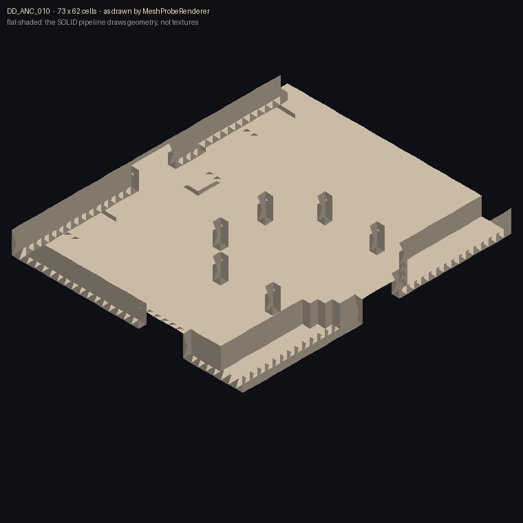

# Minecraft Dungeons environment assets — conversion record (0.40.0)

Everything in this file was produced from the user's exported Minecraft Dungeons project share
(Drive root `1-baEE2gsiF4G-lY2_2GUZttTOv39lBXo`). No asset here is hand-drawn, and nothing is claimed
as working in-game until someone loads it — see **Verification status** below.

## Where the files went

| Path | What it is |
| --- | --- |
| `assets/sift/textures/block/` | environment tiles: the overworld atlas, blurred pixel noise, two sky cubemaps (6 faces each) |
| `assets/sift/textures/entity/` | the rift window masks (portal-view front/back) and the Deep Dark portal light ray |
| `data/sift/structures/<ROOM>.json` | converted room records: footprint, heightfield, doors, tags |
| `data/sift/structures/gltf/<ROOM>.gltf` | terrain meshes for those rooms, openable in Blockbench |
| `data/sift/structures/rift/<LEVEL>.json` | the level layout sheets (`Meadow_Rift_1/2/3`, `Ravines_Dungeon_1`, `Meadow_Boss`) |
| `data/sift/structures/index.json` | machine-readable inventory of every shipped asset with its source |

**Namespace note:** the mod's own id stays `entersift`; these files sit in a `sift` namespace exactly as
requested, which is legal — any resource on the classpath is reachable as `new ResourceLocation("sift", …)`.
Code that reads them must use `sift`, not `entersift`.

## How each piece was converted

`tools/ue_tex.py` — cooked UE texture to PNG, stdlib only (plus `texture2ddecoder` when installed for
BC7/ASTC; `pip install texture2ddecoder`).

* The pixel payload of a cooked texture starts **16 bytes after the `PF_…` string** that sits in the
  header. That offset is confirmed on a file whose decoded 1024×512 landscape silhouette was inspected by
  eye, and the 8-byte-early variant of the same file decodes to the same silhouette with colour noise —
  which is how the offset was pinned down.
* Dimensions cannot be derived from the payload (a DXT5 stream resliced at the wrong width stays locally
  smooth), so the tool looks for the mip pair in the header first (`header_dims`) and reports where the
  dimensions came from in `index.json`: `header mip sizes`, `ue_dims.json (eye-verified)`, or
  `shape prior (not verified)`.
* The hand-written BC3 decoder was cross-checked against `texture2ddecoder`; the check found a real bug
  (the colour half was writing opaque alpha over the alpha half — fixed, comment in `decode_bc3`). It now
  agrees with the reference on 93.5% of pixels exactly, with the rest being endpoint-rounding on the
  3-colour mode.

`tools/dungeons_geo.py` — level data to glTF + structure records.

* `height-plane`, `walkable-plane`, `region-plane`, `region-y-plane` are zlib+base64 and decompress to
  exactly `sizeX × sizeZ` bytes — one height byte per ground column. Verified for all 12 shipped rooms.
* Meshes are built from the height plane with skirts down to lower neighbours, `--mesh-step 2` (shipped)
  so the twelve models total ~5.4 MB instead of ~20 MB. Full resolution: drop `--mesh-step`.
* Level sheets carry a `//` art banner and are parsed with comments stripped.

## Verification status (read this before trusting anything)

* **Inspected by eye:** `T_PortalView_Singer_Front` (1024×512 landscape with a walled meadow, banner
  poles and a ridge — its alpha channel is the terrain mask), `T_PortalView_DD_Front` (512×1024, a
  striped Deep Dark curtain over a ground plane) and the 512×1024/1024×512 dimension call itself.
* **Structurally validated only:** every other PNG (correct format, size and header-derived dimensions —
  no human has looked at the pixels), all twelve glTF meshes (buffer lengths, index ranges, triangle
  counts) and all room records (heightfield length vs footprint).
* **Not in-game:** none of this has been rendered by Minecraft. Wiring it into the rift is the next step.

## What did not convert

| Asset | Why |
| --- | --- |
| `T_Lobby_Forground`, `T_Lobby_Mountains_Left` | header says `PF_DXT5` but the remaining bytes match no single-mip or mip-chain payload for any power-of-two shape (tried every offset ±8 KB); needs the real header layout, not a guess |
| `T_SoulPath_Flowmap01_256.ubulk` | a bare `.ubulk` payload with no `.uasset` twin — no pixel format, dimensions or offsets to work from |
| `blocks` (voxel ids, 2.5 bytes/voxel) | packing undecoded, so meshes come from the height plane only; recorded per room in `blocks.layout` |
| minimap textures (`*_Minimap`) | **filtered by request** — UI only. They are the footprint maps for tiles like `MD_DE_STAIR_001_MW`; say the word and they can be added |
| everything under `UI/`, `Fonts/`, `Text/`, quest and combat data | filtered by request |

## Where the "rift" actually is (0.42 findings)

A research claim came in that the level-sheet banner spells **"MCD TILE LAYOUT"** and that the mesh names
carry a hidden `_WES`/`_MESS` suffix. Both are wrong, and the files say so:

* **The banner is a stylised wordmark, not a legend.** Row 1 reads `N   TOUCHI` (N + TOUCH + the start of a
  third group) and row 5-6 read `HI!!!` / `!! !!!` — the right-hand group is letters with three `!` at the
  end, and it is the *same banner in every sheet* (`Meadow_Rift_1`, `Ravines_Dungeon_1`, `Meadow_Boss`).
  A legend would differ per level; a studio wordmark does not.
* **There is no `_WES` or `_MESS`.** The strings in the sheet are `MD_DE_STAIR_001_MW`, `LG_R_FLAT_001_MW`,
  `XL_002_MW_P1`. The trailing `_MW` is the realm suffix (Meadow; Ravines tiles end `_RA`) and the leading
  `LG`/`MD`/`SM`/`XL` is the size class — that part of the claim is right, and it is already what the
  decoded sheets show: `Meadow_Rift_*` lists `*_MW` dead-ends, `Ravines_Dungeon_1` lists `*_RA` ones.

**The right framing, from the data:** the game composes missions from tiles, so the "rift" is not an asset
anywhere. It is three separate things, and all three are already converted:

1. **The portal's visuals** — `T_PortalView_Singer_Front/Back`, `T_PortalView_DD_Front`, `T_DDPortal_LightRay`,
   converted in 0.40 and waiting to be drawn behind the rift's opening. This is the part that looks like a rift.
2. **The rift missions** — `Meadow_Rift_1/2/3` level sheets (stretches of `*_MW` tiles), already in
   `data/sift/structures/rift/`.
3. **The rooms those missions are built from** — see below.

### The tiles (0.42)

`T_SiftMeadow_<TILE>_Minimap` is not a picture of a room — it is per-tile **data** at the tile's real cell
resolution. The dimensions sit in the two int32s immediately before the format string and are not powers of
two; every one accounts for its file size exactly:

| Tile | Cells | Payload fit |
| --- | --- | --- |
| `MD_L_FLAT_001_MW` | 41x31 | exact, 36-byte tail |
| `LG_R_FLAT_001_MW` | 50x41 | exact, 36-byte tail |
| `MW_FIGHT_001` | 64x37 | exact, 36-byte tail |
| `XL_005_MW_P1` | 87x74 | exact, 36-byte tail |

Channel structure, measured: **R** takes 3-4 discrete values (0/85/170/255) in large contiguous regions →
a 4-class region mask; **G** is small integers with a mean neighbour delta under 1.0 → a smooth scalar
field; **B** and **A** are constant bar two stray pixels. The four take-away values are NOT confirmed as
"walkable"/"height" — nothing in the export pairs a minimap with its own tile's object group, so the plans
ship with the raw values and the semantics unlabelled. The plans live in `data/sift/tiles/` (mask run-length
encoded, field one byte per cell) with the structural facts pinned by tests.

`meadowa1_portaltile` is one of those rooms and is the only object in the whole export named for a portal:
**`PortalTile`, 159x89x144**, height 0..88, 22 896 ground columns, 22 830 of them in a region. It ships as a
room record, a Blockbench model and a probe mesh — summon it with `{Mesh:"PortalTile"}`.

### The voxels are RLE-compressed and verifiable (lead, not decoded)

`PortalTile` ships `blocks_RLE` + `blocks_MD5` where the older rooms ship a plain `blocks` array. That is
good news: the recorded MD5 is a **pass/fail oracle** for any future decoder, so the voxel ids can be
recovered without guessing. Three attempts (u32 pairs, alternating run lengths, u8 pairs) did not reproduce
the hash, so nothing is claimed — the decoded RLE stream is 529 382 bytes for 2 037 744 voxels and its
values are not a simple monotone index list. `PortalTile.json` records the hash, the byte count and this note.

## The mesh probe (0.41, experimental)

The cooked Unreal **static meshes** on the share (`SM_MA2_Portal`, `SM_RavineBG_01`, `SM_DD_Ceiling_*`, …)
are **not** decodable yet, and this is why: the `.uasset` does contain packed per-vertex data (an 8-byte
normal/tangent block, confirmed), but there is **no float32 position buffer anywhere in the file** —
scanning every 4-byte offset for both 12- and 16-byte strides finds no window with real 3D spread, and the
`.ubulk` has no zlib streams and no float vertex block either. Positions are quantised or live in a
container this tool does not understand. Guessing strides would produce a mangled mesh presented as a real
one, so nothing is claimed.

What the probe *does* draw is the game's level data:

```bash
python3 tools/export_mesh_bin.py src/main/resources/data/sift/structures \
        src/main/resources/assets/sift/meshes --step 2
```

That turns each room's `height-plane` into an `SFM1` blob (quads for drawing + a column table for the
floor) and ships all twelve Deep Dark rooms in `assets/sift/meshes/` (3.0 MB, 1 275–11 248 quads each,
every one inside the 48 000-vertex budget).

In game:

```
/summon entersift:mesh_probe ~ ~ ~ {Mesh:"DD_ANC_010"}
```

* `/summon entersift:mesh_probe ~ ~ ~` uses `DD_ANC_010` (the smallest room, 73x62).
* `Mesh` picks any id from `MeshProbeData.IDS`; `Floor:0b` shows the mesh without touching blocks.
* Kill it (`/kill @e[type=entersift:mesh_probe]`) and the barrier floor comes back up.
* `mesh_probe=false` in `config/entersift-client.properties` hides the drawing without touching the world.



*`DD_ANC_010` flat-shaded from above: a 73x62 floor with perimeter walls and four openings, which line up
with the four dead-end doors the level data records at (32,26,61), (0,26,17), (32,26,0) and (72,26,17) —
the geometry and the door table agree. The scattered blocks are interior pillars.*

**The barrier floor.** The mesh has no collision of its own, so the entity lays a barrier at the surface
height of every ground column, 384 per tick, **only where the block is already air**, and remembers how far
it got. On removal it clears exactly those columns, and only where the block is still a barrier. Nothing in
the world is overwritten, and the block count is capped at 24 000.

**Known limits of the experiment.** The drawn surface is not walkable by itself — you stand on the barrier
layer, which sits at the mesh's surface height per column, so steep steps behave like a staircase of
full blocks rather than the smooth mesh. The mesh draws through `SiftBudget.take`, so a room larger than the
shared 48 000-vertex budget would be drawn partially rather than wrongly. And this is a probe: it draws the
room's layout, not the game's textured models, and it is not part of the rift (the rift is walk-through and
needs none of this).

## Regenerating

```bash
python3 tools/ue_tex.py <dir-of-uasset-files> <outdir>          # cooked textures -> PNG
python3 tools/dungeons_geo.py <dir-of-json-sheets> <outdir> --mesh-step 2
python3 -m unittest tools/test_data.py                          # the gates below
```

`test_data.py` now gates the shipped result: every texture is a real PNG of the size `index.json`
records and no texture path mentions UI/menu/HUD/icon/font; every room's heightfield decodes to exactly
`sizeX × sizeZ` bytes with min/max inside the volume and doors inside the footprint; every glTF's buffer
length, buffer views, triangle count and index range are self-consistent; every rift sheet has an id,
object groups, and stretches that are either tiles or a single anchor encounter.

## The rift window now draws a Dungeons matte (0.43)

The two DXT5 portal-view sheets are wired into the rift's window pass, and the BC7 ones are quarantined.
What the data actually is, measured on the converted PNGs:

| sheet | RGB | alpha | use |
| --- | --- | --- | --- |
| `rift_view_meadow_front.png` (from `T_PortalView_Singer_Front`) | grey, mean saturation 0.055 | coverage: 0 across the top half, bottom band mean 139 of 255, stippled | the temperate rift styles (0, 3, 5, 6) |
| `rift_view_deepdark_front.png` (from `T_PortalView_DD_Front`) | coloured, mean saturation 0.276 in the mid region | coverage: 0 top, bottom band mean 200 | the dark rift styles (1, 2, 4, 7) |

So they are **mattes, not paintings**: the alpha is the destination's terrain coverage and the RGB is
detail inside it. The shader (`core/rift.fsh`, `#ifdef RIFT_VIEW`) therefore keeps its own sky, cover-fits
the sheet to the opening by `textureSize` (the deepdark one is portrait 512x1024), slides it by the view
ray so the picture parallaxes as you walk past, and thresholds the stippled alpha with
`smoothstep(0.15, 0.55, ...)` so the dither reads as solid land instead of a haze. The land's own colour
survives at 40 per cent and the rest is the rift's palette times the sheet's luminance, which is what the
grey meadow sheet is for. `rift_art=false` in `config/entersift-client.properties` returns the 0.36-0.39
procedurally painted destination.

### Quarantined: 13 payloads that are not BC7 block streams

`sky_fd_face0-5`, `sky_wellspring_plains_face0-5` and `rift_view_meadow_back` decoded to per-pixel noise.
The reason is in the bytes, not in the decoder: scoring the BC7 mode histogram (the mode is the count of
leading zero bits of the first block byte) over 256 blocks at every 4-byte offset gives a *uniform* spread
- best mode-6 share 0.12, top-two share 0.58 - where real BC7 art concentrates in one or two modes. The
payloads are wrapped (Oodle is the usual suspect in this asset set, the same signature the UE meshes
show), so they are **not shipped**, live under `art/undecoded/` with the full write-up, and a contract test
forbids any reference to them. The Sift sky keeps using its own procedural shader.
